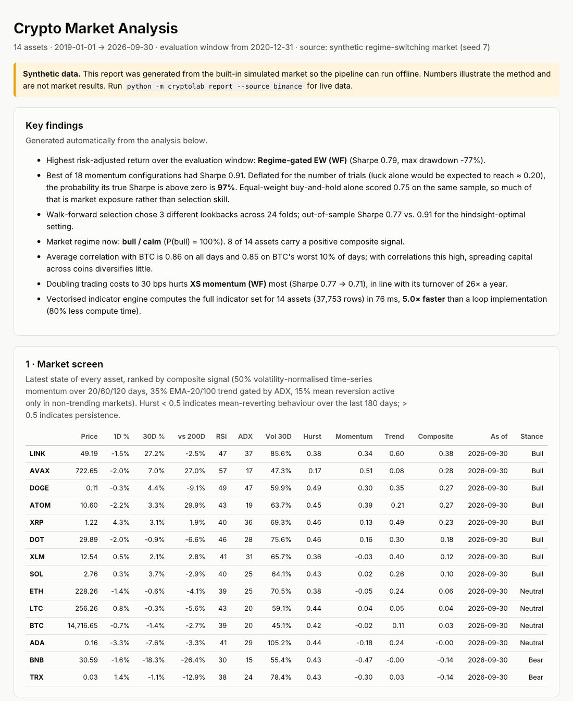

# Crypto Market Analysis (`cryptolab`)

[](https://github.com/krishnanjain2276/crypto-market-analysis/actions/workflows/tests.yml)


A research toolkit for 14 large-cap crypto assets, written in Python with NumPy and pandas. It
pulls daily candles from Binance, cleans them, builds indicators and signals, detects market
regimes with a hidden Markov model, backtests a handful of strategies, and writes everything up
as one HTML report.

Most of the effort went into making the backtests honest: no look-ahead, realistic costs,
parameters chosen walk-forward, and error bars on every Sharpe ratio.

[See the demo report →](https://krishnanjain2276.github.io/crypto-market-analysis/) (synthetic data)



## Quick start

```bash
git clone https://github.com/krishnanjain2276/crypto-market-analysis.git
cd crypto-market-analysis
pip install -e ".[dev]"
pytest -q                                                 # 44 tests

python -m cryptolab report --source binance --start 2019-01-01
python -m cryptolab screen --source binance --csv today.csv
python -m cryptolab benchmark --source binance
```

The first Binance run downloads about eight years of daily candles and caches them under
`data/cache/`, so later runs only fetch the new days. If `api.binance.com` is blocked where you
are, the downloader falls back to Binance's public mirror (`data-api.binance.vision`). With no
internet at all, `--source synthetic` runs the whole pipeline on a simulated market.

## What's in it

| Module | What it does |
|---|---|
| `data.py` | Binance download with paging, retries, a fallback host and an incremental CSV cache. Cleaning that fixes and logs duplicate days, gaps, impossible OHLC bars and extreme moves. A regime-switching synthetic market for tests. |
| `indicators.py` | SMA/EMA, RSI, MACD, Bollinger, ATR, ADX, stochastic, Keltner, Donchian, OBV, VWAP, close-to-close, Parkinson and EWMA volatility, z-score, Hurst exponent. All vectorised, with Wilder smoothing where Wilder defined it. |
| `signals.py` | Volatility-scaled time-series momentum, an ADX-gated EMA trend, mean reversion that only fires in quiet markets, a composite score, cross-sectional momentum and a daily screen. |
| `regime.py` | A Gaussian HMM written from scratch: scaled forward-backward, Baum-Welch with restarts, Viterbi, causal filtering vs smoothing, BIC to choose the number of states. |
| `risk.py` | CAGR, Sharpe, Sortino, Calmar, drawdown depth and length, historical / Gaussian / Cornish-Fisher VaR, CVaR, rolling beta, correlation on stress days, calendar-year returns. |
| `portfolio.py` | Ledoit-Wolf shrinkage, inverse-vol, risk parity (cyclical coordinate descent), capped long-only minimum variance (projected gradient). |
| `backtest.py` | One-bar execution lag, fees and slippage on drift-aware turnover, listing dates, rebalance calendars, no-trade bands, causal vol targeting, walk-forward loop, and re-running any strategy at a different cost level. |
| `stats.py` | Probabilistic and Deflated Sharpe Ratio, minimum track record length, stationary-bootstrap confidence intervals. |
| `report.py` | The HTML report: key findings, screen, performance, year-by-year returns, cost sensitivity, statistical checks, regimes, risk, indicator panel, data-quality log. |

Universe: BTC, ETH, BNB, SOL, XRP, ADA, DOGE, AVAX, DOT, LINK, LTC, TRX, ATOM, XLM (USDT pairs).

## Strategies

All long-only spot, all paying 10 bps fees plus 5 bps slippage, all scored over the same
out-of-sample window (everything after the first two years, which are used for training).

1. **BTC buy and hold** and **equal-weight** (monthly rebalance) as benchmarks
2. **Composite trend:** per-coin composite signal, inverse-vol sized, then vol-targeted
3. **Risk parity:** monthly equal-risk-contribution weights on a shrunk covariance matrix
4. **Regime-gated equal-weight:** exposure scaled by the HMM's filtered probability of a bull
   regime, with the HMM refitted every 90 days on past data only
5. **Cross-sectional momentum, walk-forward:** every 90 days the lookback (20 to 120 days) and
   number of coins held (3 to 5) are re-picked on past data, then traded blind

The report also re-runs every strategy at 0, 15, 30 and 60 bps of costs, which shows quickly
which ones survive on signal and which on turnover. (High-turnover momentum is the one that suffers.)

## Testing

```bash
pytest -q        # 44 tests, also run on Python 3.10 to 3.13 by GitHub Actions on every push
```

* **No look-ahead.** `tests/test_no_lookahead.py` scrambles every price after a cut-off date and
  checks that no indicator, signal or volatility scaler changes before it. Another test pins the
  timing rule: weights set at day *t*'s close earn day *t+1*'s return.
* **Indicators match the textbook.** Each vectorised indicator is checked against a plain loop
  version in `cryptolab/_reference.py` to 1e-9.
* **Models recover known answers.** The HMM finds planted regimes (over 90% state accuracy,
  transition probabilities within 0.03); risk parity gives exactly equal risk contributions;
  minimum variance beats the alternatives.
* **Costs and data.** Re-running at zero cost leaves gross returns unchanged; the downloader
  falls back to the mirror when the main API returns HTTP 451; the vectorised Ledoit-Wolf
  matches the loop formula.

## Speed

`python -m cryptolab benchmark` times the vectorised indicators against the loop versions on the
full 14-coin history (about 38,000 rows). On my machine it's around **5× faster** (roughly 80% less
compute). Run it yourself; the number depends on the machine.

## Limitations

* **Survivorship bias.** The universe is today's large caps. Coins that collapsed (LUNA, FTT) aren't
  in it, which flatters any long-only result.
* **Not modelled:** shorting and perpetual funding, exchange outages, tax, and market impact beyond a
  flat slippage charge.
* **Short history.** Crypto has had only a few full cycles, so the confidence intervals are wide.
  The report shows them rather than hiding them.

## What I'd add next

* Perpetual futures with funding costs, so strategies can go short
* A point-in-time universe, to get rid of the survivorship bias
* Intraday data for better execution modelling
* Combinatorial purged cross-validation instead of a single walk-forward path

## Layout

```
cryptolab/   data, indicators, signals, regime, risk, portfolio, backtest, stats,
             strategies, report, benchmark, _reference (loop versions), __main__ (CLI)
tests/       44 tests: correctness, causality, models, statistics, costs, data
docs/        the published demo report and README image
```

MIT licence. Research and education only; not investment advice.
